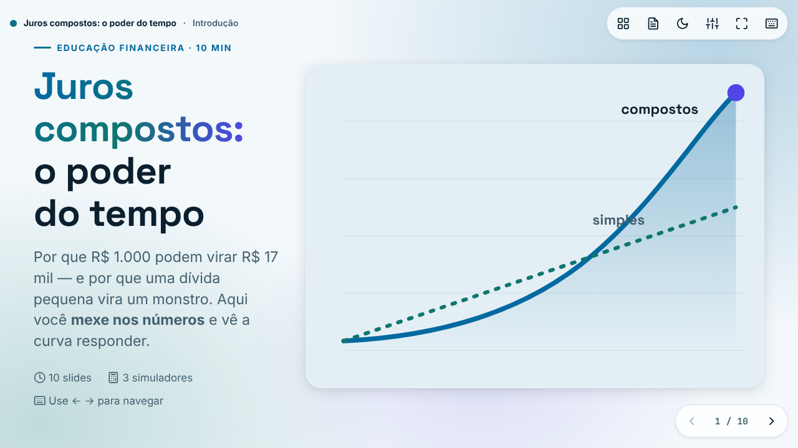
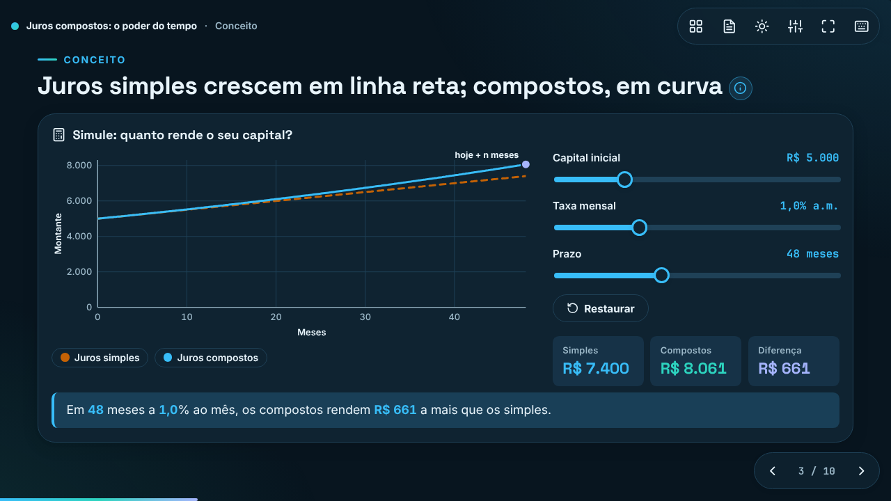
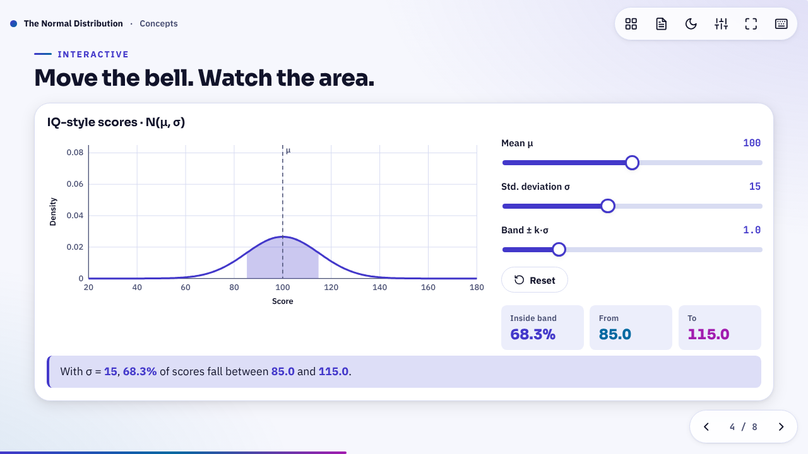
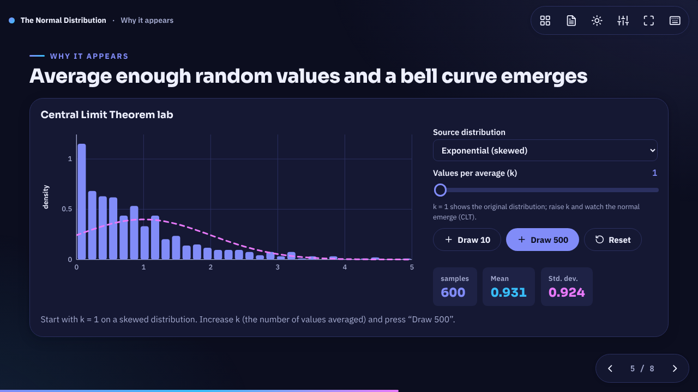

# 🎞️ Presenter Slides — skill para Claude

[](https://github.com/fbarcellar80/PresenterSkill/actions/workflows/ci.yml)
[](LICENSE)
[](docs/arquitetura.md)

**Peça ao Claude uma apresentação sobre qualquer tema e receba um único arquivo `.html`** — moderno, responsivo, com
modo claro/escuro, imagens/diagramas, **gráficos e simuladores que o público pode mexer**, ícones que aprofundam cada ideia
e navegação por teclado ou *clicker*. Funciona offline, em qualquer navegador, do celular ao projetor.

> English: see [README.en.md](README.en.md).

<p align="center">
  
  
</p>
<p align="center">
  
  
</p>

## ✨ O que a skill faz

| | |
|---|---|
| 🧭 **Planeja antes de escrever** | tese, arco narrativo, tabela de slides, **mapa de recursos gráficos**, paleta/fontes e orçamento de interatividade (`PLAN.md`) |
| 📈 **Interatividade onde importa** | curvas, estatística e cálculos viram **simuladores com sliders** (`lab`), gráficos de dados com legenda/tooltip, simulador de amostragem (TCL), quiz, abas |
| 💡 **Ícones que expandem a ideia** | botão ⓘ abre painel "saiba mais"; saltos entre slides com botão **Voltar**; dicas de glossário; *hotspots* em figuras |
| 🎨 **Design de mercado** | tipografia fluida, 9 paletas validadas (contraste **WCAG**), **claro/escuro/auto**, 5 pares de fontes, paleta de marca própria |
| ⌨️ **Controle total** | `← →`, `PgUp/PgDn` (clickers), `Espaço`, toque, `O` visão geral, `N` notas, `F` tela cheia, `B` tela preta, `T` tema, `P` paleta |
| ♿ **Acessível** | navegação por teclado, foco visível, `aria`, `prefers-reduced-motion`, contraste ≥ 4,5:1 |
| 📄 **Exporta** | arquivo único (e-mail, drive, GitHub Pages) e **PDF** pelo navegador (1 slide/página) |
| ✅ **Verifica o que gera** | validador estático + QA visual automatizado (screenshots em 3 tamanhos × claro/escuro) |

## 🚀 Instalação

### Claude Code — como skill pessoal ou de projeto
```bash
git clone https://github.com/fbarcellar80/PresenterSkill.git
# pessoal (todos os projetos):
mkdir -p ~/.claude/skills && cp -r PresenterSkill/skills/presenter-slides ~/.claude/skills/
# …ou só neste projeto:
mkdir -p .claude/skills && cp -r PresenterSkill/skills/presenter-slides .claude/skills/
```

### Claude Code — como plugin (marketplace)
```text
/plugin marketplace add fbarcellar80/PresenterSkill
/plugin install presenter-slides@presenter-skill
```

### Claude.ai / aplicativo (upload de skill)
Compacte a pasta `skills/presenter-slides` em um `.zip` (a pasta inclusa, com `SKILL.md` na raiz dela) e envie em
a área de **Skills** das configurações. (Os scripts `python`/`node` exigem um ambiente com execução de código.)

**Requisitos**: Python 3.9+ (stdlib) para `new_deck`/`build_deck`/`validate_deck`; Node 18+ e [Playwright](https://playwright.dev) *apenas* para o QA visual (opcional).

## 💬 Como usar

Basta pedir em linguagem natural; a skill é acionada sozinha:

> *"Crie uma apresentação de 10 minutos sobre **juros compostos** para leigos, com gráficos interativos e modo escuro."*
>
> *"Monte slides sobre **fotossíntese** para o 7º ano, com diagramas e um quiz no final. Use cores de natureza."*
>
> *"Preciso de um deck sobre **distribuição normal** — quero que a turma mexa na média e no desvio-padrão."*
>
> *"Pitch de 5 minutos da minha startup de logística. Marca azul `#0B5FFF`. Inglês."*

O Claude fará: **briefing rápido → plano (`PLAN.md`) → slides → validação → QA → entrega** com o caminho do `index.html`.
Para ajustar: *"troque a paleta para forest"*, *"divida o slide 4 em dois"*, *"adicione um simulador de IMC"*.
Mais exemplos e dicas em [docs/guia-de-uso.md](docs/guia-de-uso.md).

## 🎮 Atalhos durante a apresentação

| Tecla | Ação | Tecla | Ação |
|---|---|---|---|
| `→` `↓` `PgDn` `Espaço` | próximo (ou revela o próximo passo) | `O` / `G` | visão geral dos slides |
| `←` `↑` `PgUp` `Backspace` | anterior | `T` | alternar claro/escuro |
| `Home` `End` | primeiro / último | `P` | trocar paleta |
| `12` `↵` | ir ao slide 12 | `N` | notas do apresentador |
| `F` | tela cheia | `B` `.` | tela preta |
| `S` | ajustes (modo, paleta, tamanho do texto) | `?` `Esc` | atalhos · fechar painéis |

## 🧪 Exemplos prontos

| Deck | Tema | Mostra |
|---|---|---|
| [`examples/juros-compostos`](examples/juros-compostos/) · [HTML](examples/juros-compostos/dist/index.html) | Finanças (pt-BR) | `lab` com 2 curvas, calculadora, regra dos 72, gráficos com troca de tipo, rosca, abas, quiz, `info-btn`, `xref`, passos, contadores |
| [`examples/normal-distribution`](examples/normal-distribution/) · [HTML](examples/normal-distribution/dist/index.html) | Estatística (en) | área sombreada sob a curva, simulador TCL, *hotspots* em SVG, scatter, z-score, quiz |

Abra o `dist/index.html` no navegador. Para ver online, ative o **GitHub Pages** (*Settings → Pages → Deploy from a branch → `main` / root*) e acesse `https://fbarcellar80.github.io/PresenterSkill/examples/juros-compostos/dist/index.html`.

## 🗂️ Estrutura do repositório

```text
skills/presenter-slides/        ← a skill (copie esta pasta para instalar)
├── SKILL.md                    fluxo de trabalho e regras (carregado quando a skill dispara)
├── references/                 guias lidos sob demanda: planejamento, design, layouts, widgets, ícones, mídia, QA
├── assets/                     motor (css/js), paletas, sprite de ícones, template, starter
└── scripts/                    new_deck · build_deck · validate_deck · qa_check · contrast
examples/                       decks de exemplo (fonte + dist/)
tests/                          unitários, conformidade da skill, e2e (Playwright)
docs/                           guia de uso, arquitetura, imagens
.claude-plugin/                 manifesto de plugin/marketplace
```

## 🛠️ Usar sem o Claude (linha de comando)

```bash
S=skills/presenter-slides/scripts
python3 $S/new_deck.py meu-deck --title "Meu tema" --palette ocean --lang pt-BR   # cria deck.json + slides.html
python3 $S/validate_deck.py meu-deck                                               # checa erros
python3 $S/build_deck.py meu-deck                                                  # → meu-deck/dist/index.html
node $S/qa_check.cjs meu-deck/dist/index.html --out meu-deck/qa                    # screenshots (requer Playwright)
```
Documentação dos componentes: [`references/`](skills/presenter-slides/references/) · arquitetura: [docs/arquitetura.md](docs/arquitetura.md).

## 🤝 Contribuindo

Veja [CONTRIBUTING.md](CONTRIBUTING.md) (como rodar os testes, adicionar paletas, ícones e widgets). Mudanças em [CHANGELOG.md](CHANGELOG.md).

## 📜 Licença e créditos

[MIT](LICENSE). Avisos de terceiros (Lucide, Google Fonts, KaTeX) em [THIRD_PARTY_NOTICES.md](THIRD_PARTY_NOTICES.md).
